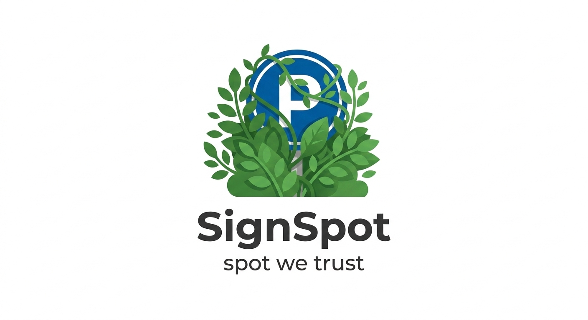

# 🅿️ SignSpot



> **Community-driven app to find free parking and report problematic paid parking worldwide**

🚀 **[Launch App →](https://signspot.streamlit.app/)**

[](https://doi.org/10.5281/zenodo.18874701)

## What is SignSpot?

A **unique community-driven app** that fills the gaps left by traditional parking apps. While most parking apps only show where you can park with payment, SignSpot helps you:

- 🚩 **Flag problematic parking signs** - Report hidden, faded, broken, or confusing signs that other apps can't track
- 🆓 **Share free parking spots** - Find and report free parking areas that commercial apps often miss
- 📍 **Report missing information** - Flag areas where parking availability is unclear — a capability traditional parking apps don't provide
- 🗳️ **Community verification** - Vote on reports to build an accurate, real-time parking map

**The Problem**: Traditional parking apps show paid zones but often have incomplete data and don't allow users to flag areas with missing or unclear parking information.

**The Solution**: SignSpot is a crowdsourced map where drivers report and vote on parking areas worldwide. Find free spots, warn others about tricky paid parking, and help everyone navigate complex parking landscapes.

## 🎯 Key Features

- 🗺️ **Interactive Map** - Click anywhere to report parking
- 🔴 **Paid Parking (Problematic)** - Hidden, faded, damaged, or unclear paid parking signs
- 🟢 **Free Parking** - Free parking spots (great finds!)
- 👍👎 **Vote on Reports** - Upvote accurate reports, downvote incorrect ones
- 🚩 **Flag Spam** - Community moderation for data quality
- 📊 **Trust Scores** - See agreement % and net votes
- 💾 **Real-time Updates** - All reports stored and synced instantly

## What to Report

**🔴 Paid Parking (Report these to warn others):**
- Hidden parking signs (behind trees, bushes, poles)
- Faded or unclear signs (hard to read)
- Missing signs (parking is paid but no sign visible)
- Damaged signs (broken or vandalized)

**🟢 Free Parking (Great finds!):**
- Street parking with no paid signs
- Free parking zones
- Community-verified free spots

Area reports appear as shaded boundaries on the map. Use the drawing toolbar to edit or delete a boundary before confirming it. Include only parking spaces covered by the same reported conditions.

## Parking restrictions

When adding a report, open **Parking restrictions (optional)** to record vehicle types, reserved access, charging requirements, hours, payment, size limits, and an official information URL. Electric **AND** authorized shared cars and electric **OR** authorized shared cars have separate options. Motorhome parking and overnight/camping permission are recorded separately. Use **Unknown** for conditions you cannot confirm.

Restrictions appear in map popups and the community reports list. Reports created before these fields were introduced show **Restrictions not recorded**.

## 🏃 Quick Start

### Online (Recommended)
Visit **[signspot.streamlit.app](https://signspot.streamlit.app/)** - No installation needed!

### Run Locally
```bash
git clone https://github.com/ramtinz/SignSpot.git
cd SignSpot
pip install -r requirements.txt
streamlit run main.py
```

## 📖 How to Use

1. **Choose a location** — Select your city and choose **Spot** or **Area**. Tap a spot, or draw a polygon and select **Use this area**.
2. **Describe the spot** — Choose free parking or a sign issue and a reason, then select **Continue to review**.
3. **Review and submit** — Add optional restrictions, confirm the map location, and submit. A confirmation appears after saving.

Use **Community reports** to browse and vote on existing reports.

## 🛠️ Tech Stack

- **Framework**: Streamlit
- **Maps**: Folium + OpenStreetMap
- **Database**: SQLite
- **Hosting**: Streamlit Cloud

## 📄 License

Non-Commercial License © 2026 Ramtin Zargari Marandi

Free for non-commercial use. Commercial use requires permission. See [LICENSE](LICENSE) for details.

## 🤝 Collaboration & Enquiries

For collaboration, feedback, or project enquiries, contact:

**ramtin.zargari AT gmail.com**

## 📚 Citation & DOI

[](https://doi.org/10.5281/zenodo.18874701)

To cite this project:

```bibtex
@software{zargari_marandi_2026_signspot,
  author       = {Zargari Marandi, Ramtin},
  title        = {SignSpot},
  year         = 2026,
  publisher    = {Zenodo},
  doi          = {10.5281/zenodo.18874701},
  url          = {https://doi.org/10.5281/zenodo.18874701}
}
```

Citation metadata is also available in [CITATION.cff](CITATION.cff).

## ⚠️ Disclaimer

**Use at your own risk.** SignSpot is a crowdsourced app - data accuracy depends on community contributions. Always verify parking rules yourself before parking.

**Legal Responsibility:** Users are solely responsible for ensuring that their use of SignSpot complies with applicable laws and regulations in their country and local jurisdiction. The use of this app is intended only for legal purposes. The developer assumes no responsibility for any legal consequences resulting from users' use of the app in violation of local, regional, or national laws.

---

**Find free parking, warn others about tricky spots! 🅿️✅**
